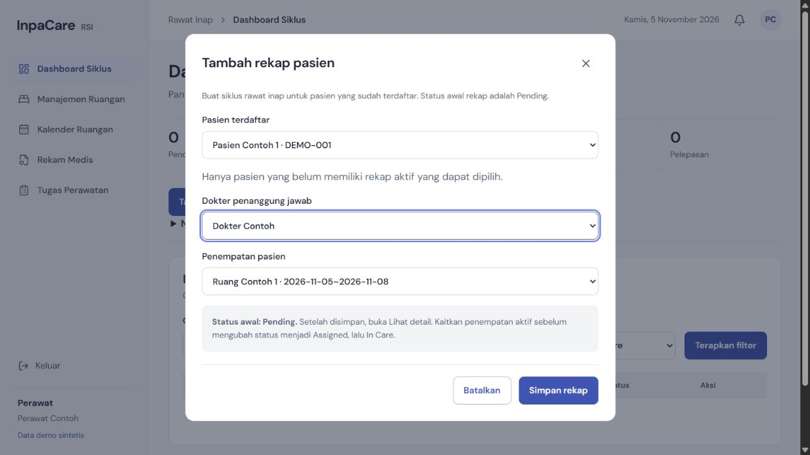
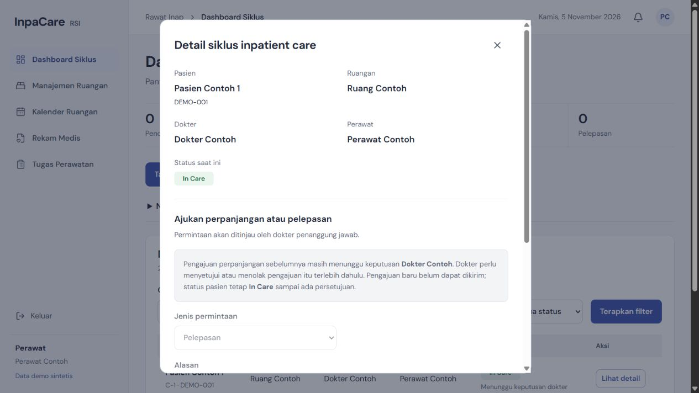

# Tambah rekap pasien

The DBP UC-02 evidence in [requirements-evidence](../planning/sources/requirements-evidence.md) describes a nurse creating a pending recap for an already registered patient. A recap starts a care cycle; it does not register a new patient or change an existing cycle to In Care.

The creation modal follows the Figma dialog structure while selecting existing patient and doctor records required by the API. Eligible patients come from a nurse-only endpoint, independent of dashboard filters and nurse ownership. Patients with an undeleted, unreleased cycle are excluded. The write checks again under the patient lock to handle concurrent creation. The existing database unique index remains the final constraint.

Only the selected patient's active placements are offered. A single matching placement is selected automatically; changing patient resets this selection. A patient without placement may start Pending, then link placement in Lihat detail before progressing to Assigned and In Care. After creation, dashboard filters reset so the new Pending recap is visible.

## Validation

- API type check and build; web Svelte check and production build.
- API tests: candidate access, duplicate prevention under the patient lock, wrong-patient placement rejection, and unplaced Pending creation, plus the existing unit/contract suite.
- Existing frontend unit tests and architecture checks.
- Browser check using a local synthetic API fixture: modal opens, candidates remain available with a dashboard status filter, another patient's placement is absent, matching placement is automatic, changing to an unplaced patient clears it, a simulated conflict preserves the draft and shows an inline error, successful submission closes the modal, and an empty candidate list gives an explanation.
- The fixture browser check validates UI behavior; it does not replace a PostgreSQL integration run. No records were created in the shared deployment.

## Pending doctor decisions and release visibility

The old detail view hid the entire release/extension form when a request was pending. An In Care patient then appeared to have no next action. Keep the section visible with disabled controls and explain which request is waiting for which doctor. Also show "Menunggu keputusan dokter" alongside the care status in the table. New requests remain blocked until the existing request is decided, preserving the current approval rules.

Verified in a local synthetic browser fixture: a patient with a pending extension displays the explanation and disabled release form; a patient without a pending request has an enabled release selector and submit button. Svelte check reports zero errors/warnings; the production build passes. No request or decision was submitted on the shared deployment.

## Deployment

Deploy API and frontend together because the dashboard now calls `GET /api/v1/cycles/creation-candidates`. No database migration is needed. Run the PostgreSQL workflow/integration gate in CI before merging.
