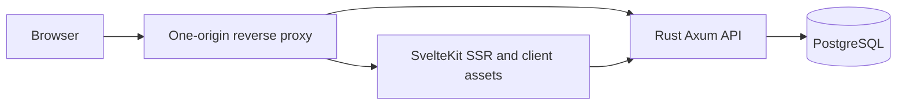

# InpaCare — proposed technical design

Date: 2026-10-29. This document describes the full-product technical direction. The [one-day implementation plan](IMPLEMENTATION_PLAN.md) controls the initial timebox and reduced demo scope; a design item here is not automatically a day-one commitment. Product facts come from the [captured Modul 2 evidence](sources/requirements-evidence.md); unresolved source behavior is tracked in [requirements and decisions](REQUIREMENTS_AND_DECISIONS.md). Proposed additions below are not presented as existing requirements or implemented code.

## Stack and runtime responsibilities

| Area | Decision | Responsibility |
| --- | --- | --- |
| Browser UI | Svelte, SvelteKit, TypeScript; scoped CSS and shared design tokens initially. | Final-page screens, interactive forms/tables/calendar, navigation and recoverable UI states. |
| Initial rendering | SvelteKit SSR through the Node adapter, followed by client navigation. | Render the initial authorized page with its data. Keep browser-only widgets deferred where needed. |
| Business API | Rust, Axum, Tokio, Tower middleware, Serde. | Authentication/session authority, data access scope, validation, workflows, transactions and errors. |
| Database access | SQLx with the PostgreSQL driver, shared bounded pool, migrations and checked query macros where practical. | Explicit SQL and transaction boundaries. Commit compatible query metadata/lockfiles for reproducible builds. |
| Storage | PostgreSQL. | Canonical domain data, histories, persisted notifications, and initial session storage. |
| API contract | OpenAPI plus a generated TypeScript client/types. | Keep serialization, nullability and errors consistent across Rust and TypeScript. Select the generator during M1; avoid maintaining a second handwritten DTO model. |
| Hosting boundary | Caddy, one public origin; private frontend/API/database services. | TLS/routing, static asset caching and streaming where enabled. |
| Live updates | Mutation responses and explicit cache invalidation first; scoped SSE if accepted for cross-session freshness. | Refresh changed resources after committed writes. Source notifications must persist independently of an SSE connection. |

SvelteKit normally combines initial SSR with client-side navigation; the Node adapter provides a standalone server. Axum uses Tokio/Hyper and the Tower middleware ecosystem. SQLx supports Tokio and asynchronous SQL. References: [SvelteKit rendering](https://svelte.dev/docs/kit/project-types), [Node adapter](https://svelte.dev/docs/kit/adapter-node), [Axum](https://docs.rs/axum/latest/axum/), [SQLx](https://docs.rs/sqlx/latest/sqlx/).

Use one Rust application with modules and one PostgreSQL database. This gives cross-module operations a local transaction boundary. Framework and compiler versions are pinned and compatibility-checked when scaffolding; this plan does not assume that an untested collection of latest packages is compatible.



Route `/api/v1/*` to Rust and application routes/assets to SvelteKit. SvelteKit server loads use a fixed trusted internal API address and forward only the requesting user's session context. Rust rechecks authentication and authorization on every call. The Node layer handles rendering and adaptation; the domain rules remain in Rust. Store no per-user data in process-global frontend state.

## Proposed repository layout

This is a layout proposal, not a scaffold created by this planning task.

```text
apps/
  web/                         SvelteKit app and component tests
  api/
    src/
      auth/                    sessions and actor resolution
      access/                  role/capability and record-scope policy
      rooms/                   rooms and ItemRuangan
      placements/              occupancy and calendar queries
      cycle/                   RekapPasien and doctor decisions
      tasks/                   task workflows and history
      medical_records/         records, conditions and vitals
      billing/                 invoices, details and history
      notifications/           persisted source-defined notifications
      reference_data/          permitted patient/staff/context lookups
    migrations/
    tests/
contracts/openapi.yaml         agreed public API shape
tests/e2e/                    cross-module browser scenarios
tests/performance/            repeatable workload scripts and fixtures
ops/                          local/hosted configuration and runbooks
docs/                         requirements mapping and design decisions
```

Within a backend module, keep route handling, business operations and SQL understandable and close together. Add separate abstractions only when actual sharing or testability calls for them. Preserve traceability to the source controller/model methods even when an Axum handler has a different implementation shape.

## Domain and database model

The source data model explicitly defines 17 entities at captured lines 10599–11335, with relationships at 11338–11493. Preserve their meanings and names in the mapping below. Physical snake_case table names are implementation choices.

| Source entities | Proposed tables | Responsibility and important relationships |
| --- | --- | --- |
| Pengguna, Dokter, Perawat | `pengguna`, `dokter`, `perawat` | Credentials/base role; optional unique user links to staff profiles; nurse active status. Resolve coordinator capability separately. |
| Pasien | `pasien` | Registered patient identity and current BPJS flag. Used as shared reference data; a new patient-registration UI is not established by this plan. |
| RuangInap, ItemRuangan | `ruang_inap`, `item_ruangan` | Room, PIC and status; child items with category, quantity and unit cost. |
| PenempatanPasien | `penempatan_pasien` | Patient-room date intervals and placement status. Canonical input to occupancy queries and task-placement validation. |
| RekapPasien | `rekap_pasien` | Inpatient cycle, assigned staff, current/prior/proposed status and deletion marker. Its relationship to placements must be resolved before migrations are frozen. |
| Notifikasi | `notifikasi` | Recipient, optional cycle reference, message and timestamp. Required rejection/approval-related feedback must survive page reload. |
| TugasPerawatan, RiwayatTugas | `tugas_perawatan`, `riwayat_tugas` | One active PIC per task, schedule, priority/status, creator, version and logical deletion; actor/time/action/before/after/reason history. |
| RekamMedis, KondisiPasien, TandaVital | `rekam_medis`, `kondisi_pasien`, `tanda_vital` | Doctor-authored record; nurse condition observations and their vital measurements. Keep actor-specific write scopes. |
| Tagihan, DetailTagihan, RiwayatTagihan | `tagihan`, `detail_tagihan`, `riwayat_tagihan` | Patient/optional placement; BPJS snapshot, total and payment/claim status fields; item/service quantities and price snapshots; mutation history. |

Technical additions proposed for M0/M1: a revocable `sesi` table; a protected coordinator capability; idempotency records for duplicate-sensitive actions; version columns on mutable aggregates that need conflict detection. A durable cycle-request/decision record is proposed because the documented approval workflow needs actor/time/decision evidence absent from the listed schema. These additions require an explicit schema mapping; they are not extra product modules.

Do not introduce independent payment, insurance-claim, bed-management or patient-registration modules until their intended scope is resolved. The selected document models payment and claim verification as invoice fields and equipment as room items.

### PostgreSQL adaptation of source types

The data-model notation includes MySQL-style types; map semantics deliberately rather than copying DDL verbatim.

| Source notation | PostgreSQL proposal | Reason |
| --- | --- | --- |
| `VARCHAR(36)` entity IDs | `varchar(36)` and opaque string IDs in the API | Preserves source examples such as `USR-001` and `RG-101`; do not assume all existing IDs parse as UUIDs. Generation/format policy remains a decision. |
| `TINYINT(1)` with 0/1 check | `boolean` | Nurse activity and BPJS flags. |
| `INT UNSIGNED` | Integer plus the source's explicit positive/nonnegative `CHECK` | PostgreSQL has no unsigned integer type. |
| `DECIMAL(15,2)` | `numeric(15,2)` with nonnegative checks where defined | Exact totals and prices; send money as decimal strings in JSON and calculate server-side. |
| `DATE` | `date` | Birth dates, source-defined placement dates and dates without a time of day. |
| `DATETIME` | `timestamptz` for actual instants | Audit/session/task instants; use an agreed facility timezone for presentation and date-to-instant conversion. |
| `LONGTEXT` containing before/after JSON | `jsonb`; ordinary prose stays `text` | Structured histories, without treating all text columns as JSON. |

Keep original display terminology in the UI. Use one reviewed enum/label mapping per entity; the source's `baru` task default and mixed room/cycle spellings are unresolved aliases, not silently accepted extra states.

### Integrity and transaction boundaries

- Task create/update/reassign/delete: authenticate; resolve permitted record/fields; check an active PIC and patient placement over the full task interval; apply the expected-version condition; write the task and required history together. A failed operation commits neither.
- Placement/rescheduling/cancellation/extension: serialize operations against the affected room/patient/cycle as needed, recheck availability inside the write transaction, and update the related authoritative records together. Confirm whether a room is one allocatable unit or has multiple independent places before choosing an exclusion constraint. Define what a shortened/moved placement does to existing task intervals and historical invoice links.
- Cycle request/doctor decision: verify actor and current version, record the requested change/decision, apply the agreed status/placement consequences, and persist required notification in the same transaction.
- Billing changes: validate accessible patient/placement/item references, snapshot applicable prices/BPJS state, calculate the agreed total in Rust with decimal arithmetic, write details and history atomically. A later room-price change must not silently rewrite a historical invoice.
- Medical updates: restrict doctor record fields and nurse observation fields separately; enforce source constraints and resolved deletion behavior. A model-wide update payload must not let nurses change doctor-only data.
- Use foreign keys, uniqueness and source checks alongside service validation. Plan deterministic locking order and bounded retries for retryable transaction failures. Concurrency tests must establish the chosen approach, not merely test a preflight `SELECT`.

The calendar's source note counts start/end dates inclusively. Task schedules contain instants. Resolve conversion, open-ended placements, overlap boundaries, and a task ending at a placement boundary before enforcing cross-module validation. PostgreSQL range/exclusion capabilities are options once allocation semantics are agreed: [range types](https://www.postgresql.org/docs/current/rangetypes.html), [transaction isolation](https://www.postgresql.org/docs/current/transaction-iso.html).

### Index/query plan

Start from the actual access-scoped queries and examine `EXPLAIN (ANALYZE, BUFFERS)` on synthetic representative data.

- Unique username and optional staff-user links, matching source constraints.
- Placement queries by patient, room, status and overlapping date range; use a range index where its measured query pattern and resolved interval semantics justify it.
- Active task board queries by authorized PIC/patient/room, status and schedule, with `deleted_at IS NULL`; histories by task plus time/ID.
- Cycle lists by assigned doctor/nurse, status and date; notification lists by recipient plus time/ID.
- Medical records by patient/date and observations by record/exam time.
- Billing by patient/payment status/date; details by invoice; histories by invoice/time.

Do not create every permutation of these columns. Bound list sizes/date ranges, use deterministic pagination, avoid per-row lookup queries, and include record-access predicates in SQL rather than fetching all records and filtering in the browser.

## API contract

These endpoint names are proposals mapped to the source operations. OpenAPI is written before frontend/backend implementation diverge. `GET` operations remain non-mutating.

| Group | Proposed operations | Notes |
| --- | --- | --- |
| Session | `POST /api/v1/session`, `GET /api/v1/session`, `DELETE /api/v1/session` | Verify credentials, resolve current server actor/capabilities, revoke session. |
| References | `GET /api/v1/patients`, `/patients/{id}/context`, `/staff` | Searchable scoped lookups; context is tailored to task/cycle/billing needs and permitted fields. |
| Rooms/items | `GET/POST /api/v1/rooms`, `GET/PATCH /rooms/{id}`, room-item create/update/delete operations | Source room cost is derived from item quantities × costs. Room deletion behavior is blocked on the retention/cascade decision. |
| Placement/calendar | `GET /api/v1/occupancy?from=&to=&roomId=`, `POST /placements`, `PATCH /placements/{id}`, `POST /placements/{id}/cancel` | Final includes Ubah jadwal. Placement edits repeat collision/version validation; schedule changes and cancellation's linked task/cycle/status effects require resolution. |
| Cycles | List/create/detail/update cycle plus request and decision operations under `/api/v1/cycles` | Keep a doctor decision distinct from a nurse's normal status update. Include source filtering and notification reads. |
| Tasks | List/create/detail/update under `/api/v1/tasks`; history read; explicit reassignment and deletion commands if different permissions require them | Validate allowed fields per actor and expected version. Preserve the four source UI statuses after alias resolution. |
| Medical records | List/create/detail/update plus agreed deletion under `/api/v1/medical-records`; observation/vitals operations under a record | Doctor clinical changes and nurse observations have separate request schemas. |
| Billing | List/create/detail/update plus confirmed logical deletion under `/api/v1/invoices` | Supporting reads remain read-only; invoice total is calculated by the server. Separate payment/claim transactions remain an open scope decision. |
| Notifications | Scoped `GET /api/v1/notifications`; optional `/api/v1/events` SSE | Persist source-required messages first. SSE is an optional delivery mechanism, not their source of truth. |

The table abbreviates nested paths; every operation must be expanded with method, full path, request, response, permissions and source anchors in the M0 OpenAPI artifact.

Contract conventions:

- IDs are opaque strings; do not infer authorization from an ID or accept the actor's role from a submitted form.
- JSON uses one casing convention, proposed camelCase; SQL/source names are mapped explicitly. Dates use `YYYY-MM-DD`; instants use timezone-bearing RFC 3339 values; monetary amounts use decimal strings.
- Lists carry `items` and pagination metadata. Filters, sorting and maximum limits are validated. Choose a cursor/order appropriate to each query; the UI must not require an unbounded download to render counts or a board.
- A mutable aggregate returns `version`; a write supplies `expectedVersion`. For source task updates/deletes, a mismatch is a 409 conflict and never overwrites the saved row. Extending this pattern to other aggregates is an engineering proposal.
- Use idempotency keys for duplicate-sensitive create/decision actions, scoped to actor, operation and request content. A retry must not create a second task, invoice or decision.
- Distinguish 400 malformed requests, 401 expired/missing session, 403 prohibited action (or scoped 404 where appropriate), 404 unavailable record, 409 conflict, 422 field/business validation, and sanitized unexpected errors with a request ID.

Proposed validation-error shape:

```json
{
  "error": {
    "code": "VALIDATION_FAILED",
    "message": "Periksa kembali isian tugas.",
    "fields": { "endAt": "Waktu selesai tidak boleh sebelum waktu mulai." },
    "requestId": "opaque-request-id"
  }
}
```

UI language follows Final; error codes and request IDs serve the implementation. Do not expose raw SQL errors or internal patient data in an error response.

## Identity, permissions and sessions

The source's base roles are DOKTER, PERAWAT and ADMISI. Admin/Admisi naming and the coordinator's stored capability need an M0 decision. Proposed minimal mapping: keep the three base roles, add a protected task-coordination capability to the relevant nurse profile, and treat PIC as a task relationship rather than a new global role. A capability is assigned by trusted configuration/account administration, never by a login role selector supplied by the browser.

| Actor/context | Source-backed baseline | Boundaries to settle/enforce |
| --- | --- | --- |
| Dokter | Clinical record operations and assigned-patient cycle monitoring/approval. | Exact patient scope, record deletion semantics, and which doctor may decide a pending request. |
| Perawat | Room/calendar workflows, cycle operations and patient-condition observations. | Assigned/unit scope and the permitted observation/medical fields. |
| Koordinator Perawat | Task creation and delegation; authorized task management. | Stored capability, affected unit/patient scope and exact update/delete rights. |
| Perawat PIC | Scoped task board/detail and permitted task updates. | Allowed fields, reassignment visibility, history access and behavior after loss of assignment. |
| Admisi | Billing operations and read-only patient/medical/equipment context required for billing. | Minimum visible fields, permitted patient scope and billing status/claim rules. |

Use a server-issued opaque, revocable session in a Secure/HttpOnly/SameSite cookie on the single origin. Store sessions in PostgreSQL initially; check expiry/revocation and current permissions server-side. Choose password hashing, session lifetime, account/reference-data provisioning and rate limits in M0/M1; the Figma sample credentials are not an authentication backend. Final labels the identifier as Email atau ID petugas and includes Ingat saya, whereas DOC authenticates username/password: resolve identifier aliases and remember-me lifetime rather than assuming email support. Protect cookie-authenticated mutations against CSRF, rotate sessions on login/privilege changes, and remove cached user data on logout. [SvelteKit authentication concepts](https://svelte.dev/docs/kit/auth).

UI visibility is a convenience layered over Rust authorization. Recheck record scope and field scope on every command, including stale browser tabs and SSE subscriptions. Use allow-listed updates; never deserialize an unrestricted database entity as a write request.

## Frontend plan

Proposed logical route groups: `/login`, `/dashboard`, `/patients/{id}` context, `/rooms`, `/calendar`, `/tasks`, `/medical-records`, and `/invoices`, with nested details/forms where the Final flow needs them. Patient context is a cross-module view, not an independently invented patient CRUD module. Role and modal variants of a Figma screen normally share one route/component/state model.

The [live frame map](SCREEN_IMPLEMENTATION_MAP.json) assigns all 107 observed Final screen frames to these eight route families, source requirement groups and planned visual scenarios. These are planned scenarios, not application test results. The live page has no reported prototype start node and lacks historical entry `2004:7785`; define the application's `/login` entry independently. A blank Perawat login state is a documented adaptation because it is absent from this capture.

At the source desktop width of 1440 px, the shared sidebar is 220 px and Header / Website is 1220 × 66 px. The separate support Topbar is 1184 × 72 px and is not the common website-header specification. DM Sans predominates; Inter appears in embedded input components. Observed values include #4E61F6, #131927, #FFFFFF, #E5E7EA and #F3F4F6. These are observed styles, not verified named variable tokens. Derive a small token map while preserving the relevant Final component treatment.

- Shared shell, sidebar, header and semantic tokens come from the exact Final page. Keep labels and role-specific menus traceable to verified frames.
- Implement a small shared set of form fields, buttons, badges, tables, dialogs, feedback and filters. Add libraries only for functionality that warrants them; decide calendar/table dependencies against the actual Final behavior and bundle measurements.
- Fetch an initial authorized page through SSR; parallelize independent data loads and avoid long browser request chains. Defer heavy calendar/chart code to the relevant routes. [SvelteKit performance](https://svelte.dev/docs/kit/performance).
- Keep field validation close to the form for fast feedback, and display the server's authoritative validation result. Preserve input on rejection. Handle loading, empty search results, expired sessions, missing records, denied actions, server failure and stale-version recovery deliberately.
- Use conservative feedback for consequential clinical/status/delete changes: show pending work and only show a completed authoritative state after a successful commit. Prevent duplicate submissions without losing retry recovery.
- Cache data per user/scope/filter, invalidate related views after mutation, and revalidate when a tab regains focus. Clear affected data after role/assignment loss. Do not cache clinical responses in a public CDN or persistent browser store by default.
- If SSE is selected, transmit scoped resource/version invalidations after commit, fetch fresh authorized data, and revalidate after reconnect. Persisted notifications work even when the live connection is absent. Proxy streaming and multiple API instances need explicit verification; a durable outbox/broker becomes a separate design decision if delivery guarantees require it.
- Derive smaller layouts from the desktop Final design as a proposal: retain usable navigation, scrollable tables/calendar, readable forms and reachable dialog controls. Verify keyboard focus, labels and error associations. Do not claim a mobile Figma specification where none was provided.

For test, performance and deployment acceptance, use [delivery and validation](DELIVERY_AND_VALIDATION.md).
