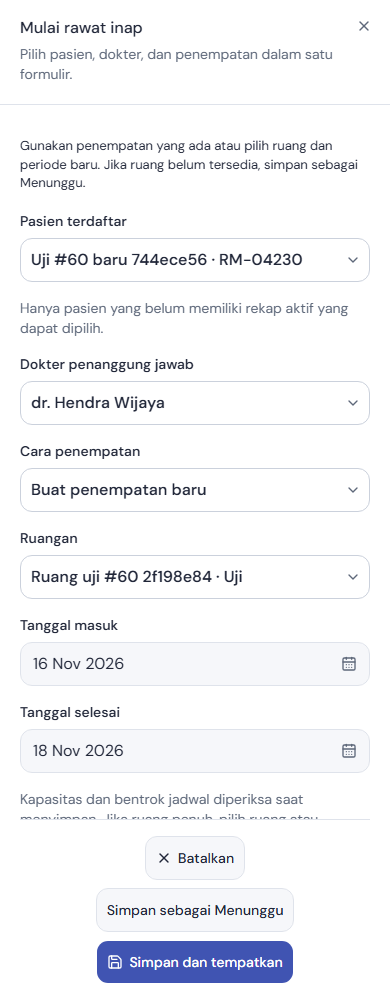
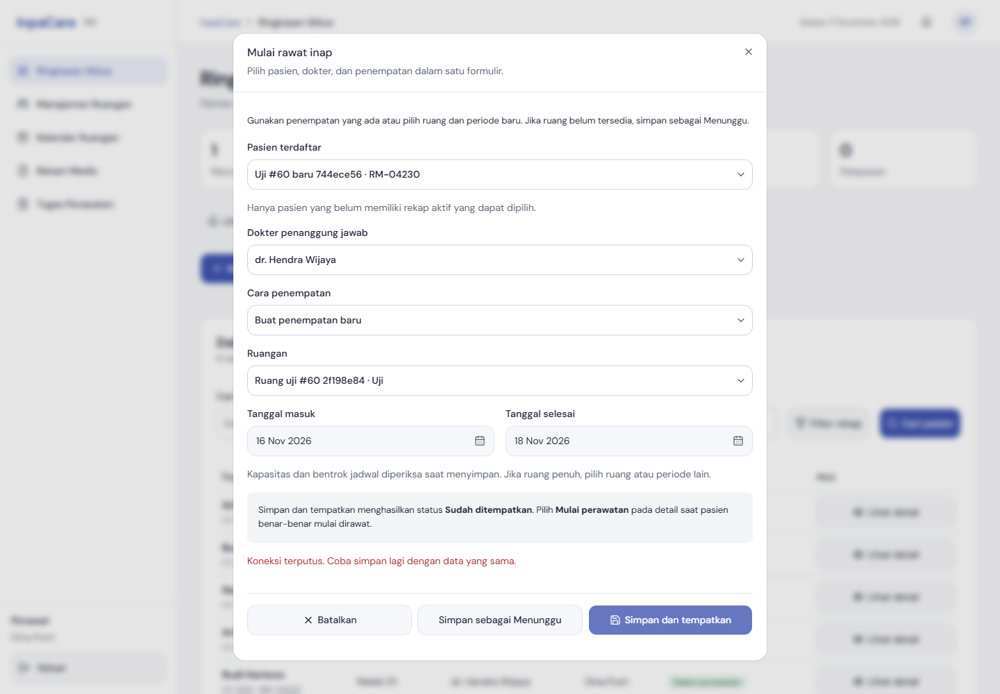

# Unified admission validation

Issue #60 combines patient, responsible doctor, and existing/new placement in **Mulai rawat inap**. A placed cycle starts as **Sudah ditempatkan**; **Mulai perawatan** remains an explicit, versioned action. **Simpan sebagai Menunggu** requires no room.

The captures below use synthetic patients and rooms on a migrated, seeded disposable PostgreSQL instance and the production web build. They show retained form values after the server committed successfully but the response was deliberately lost. Transient toasts are hidden in the captures; the inline connection error remains visible.

| 390px | 1440px |
| --- | --- |
|  |  |

Validation covers API unit/contract checks, 26 PostgreSQL integration tests, 18 HTTP workflow tests, the live response-schema test, two web transport tests, three new Playwright admission workflows, and the existing UX component suite. The admission checks include placement ownership and selection resets, duplicate submissions, concurrent capacity conflicts, rollback, role permissions, immediate detail opening, and explicit care start. Type checks and production builds also pass.

Deploy migration `CycleCreationRequests1793577600005` before the updated API and form. It adds the creation-response table without changing existing cycles or placements. Creation with a placement now returns `assigned`; API callers must honor the returned status. Validation used disposable local data and did not deploy to the shared demo.
